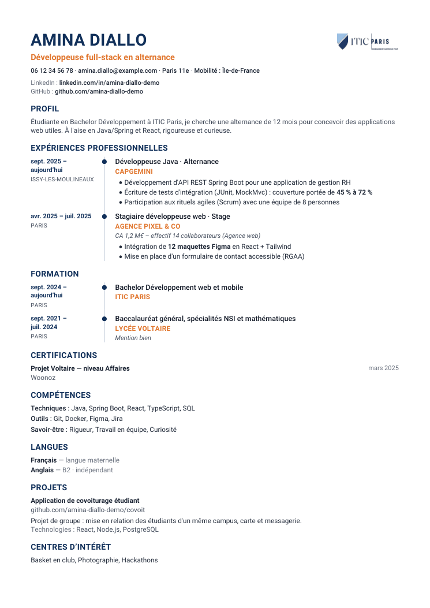
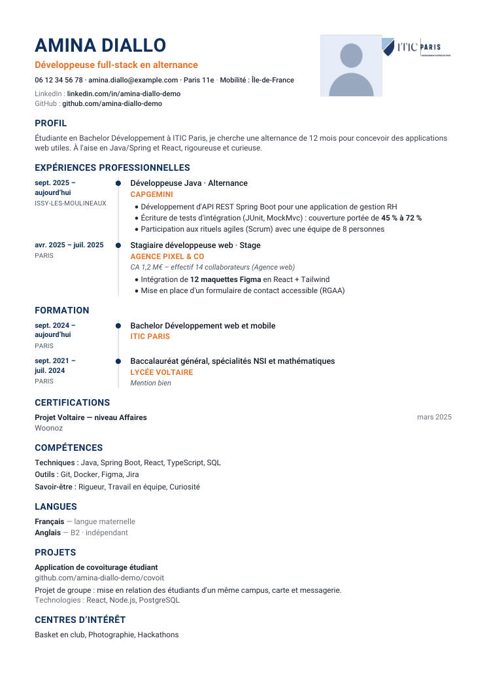
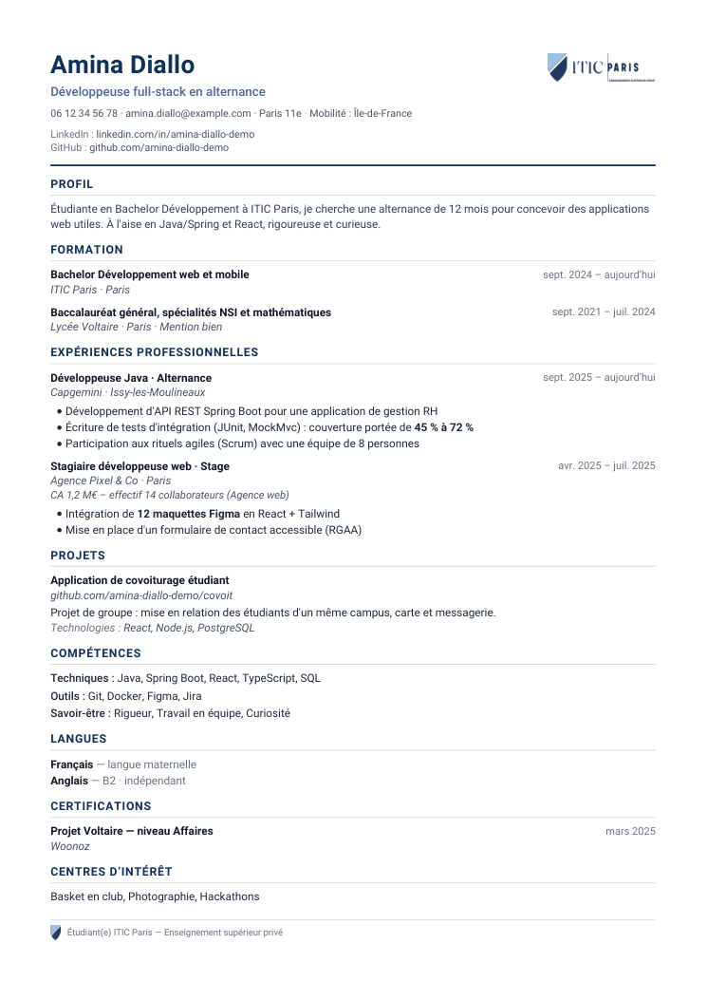
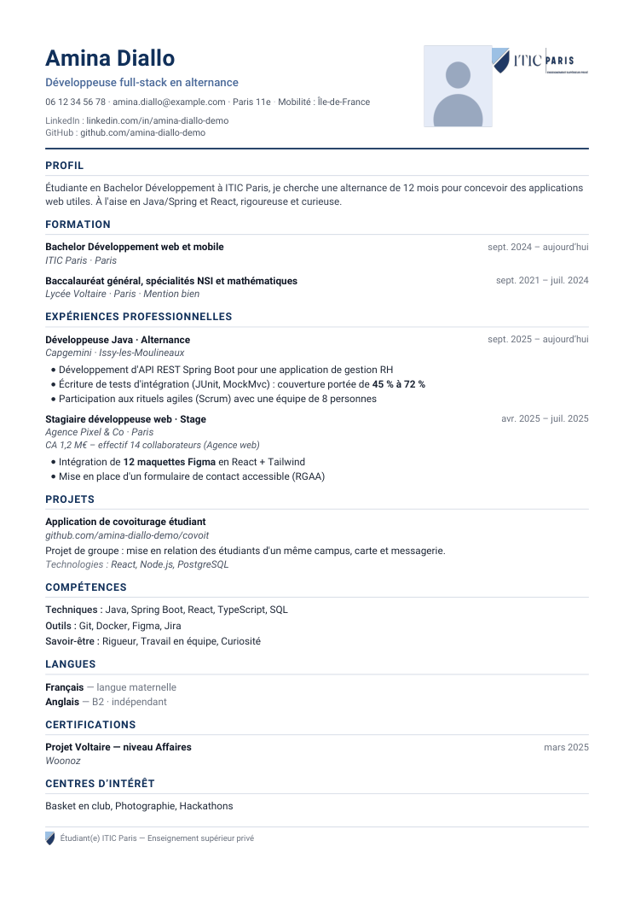
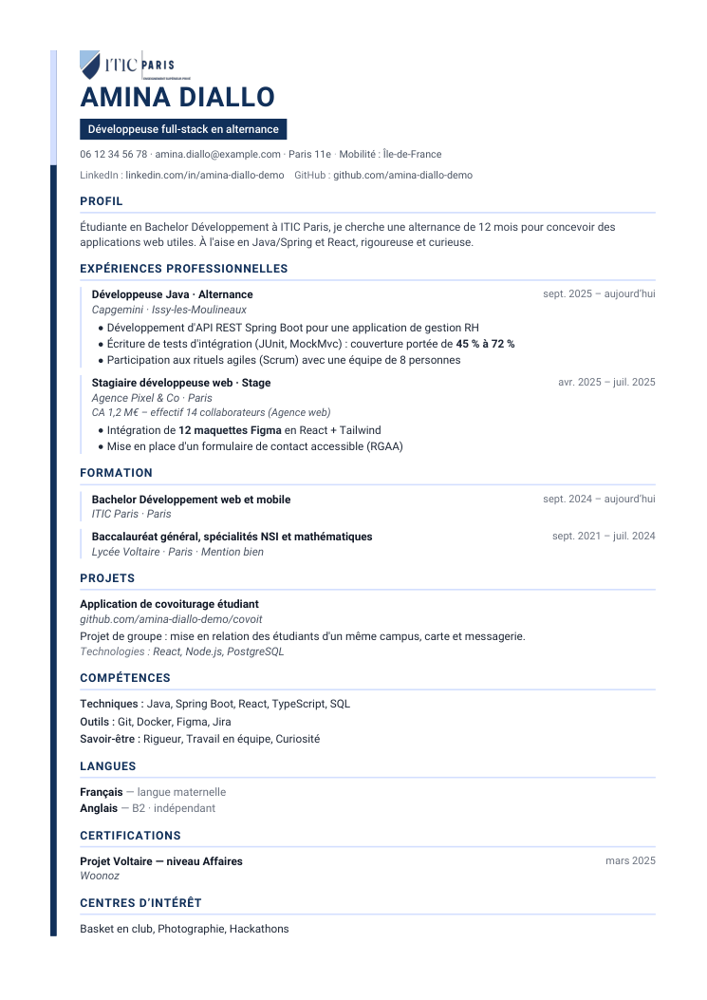
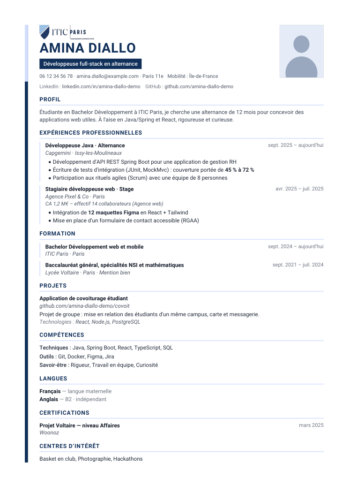
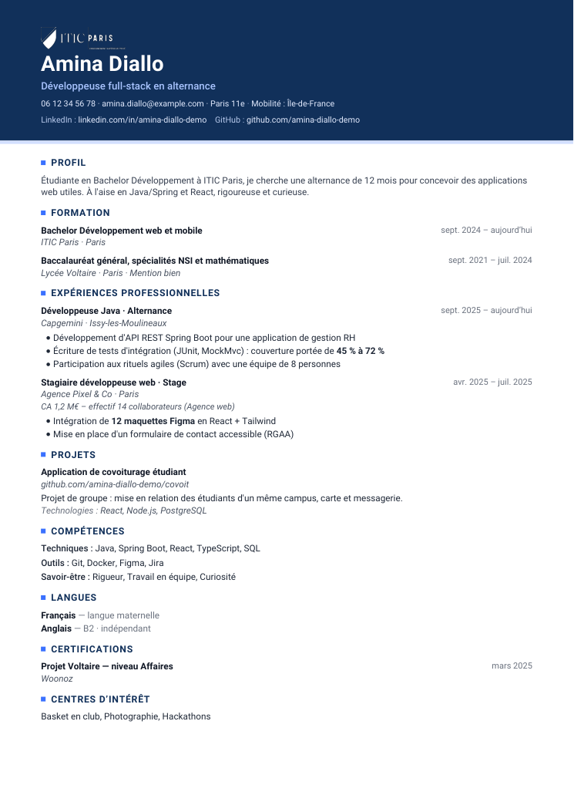
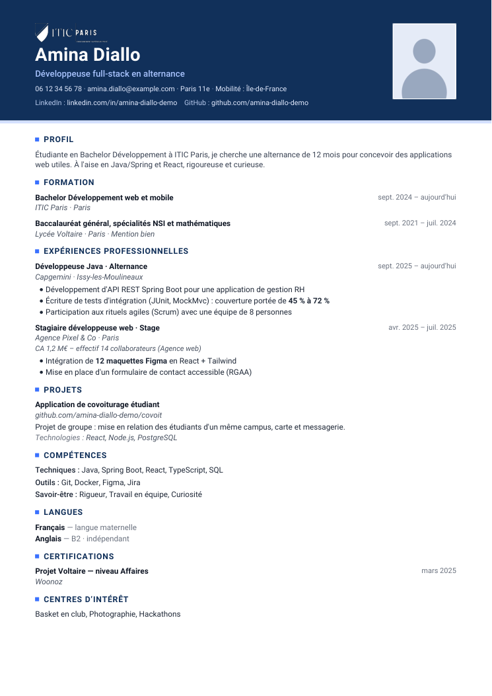

# Exemples de CV générés par l'assistant

PDF produits par le vrai moteur de rendu de l'assistant (`CvRenderService`, celui qu'utilisent
`POST /cv/builder/me/pdf` et l'envoi au conseiller), pour relire les quatre modèles.

## Captures (page 1)

| Modèle | Sans photo | Avec photo |
|---|---|---|
| Linéaire |  |  |
| Classique |  |  |
| Moderne |  |  |
| Bandeau |  |  |

## Fichiers

| Fichier | CV | Pages |
|---|---|---|
| `<modèle>-1-page.pdf` | Amina Diallo, Bachelor en alternance, sans photo (emplacement réservé, vide) | 1 |
| `<modèle>-1-page-photo.pdf` | Le même CV, avec photo | 1 |
| `<modèle>-2-pages.pdf` | Sarah Lemoine, reconversion, 5 expériences, sans photo | 2 |

`<modèle>` : `lineaire`, `classique`, `moderne`, `bandeau`.

- **Données entièrement fictives** (`CvSampleFixtures.fullCv()` et `longCv()`), e-mails en `example.com`.
- La photo est une **silhouette dessinée** par le test (aucune vraie personne).
- Depuis le 13/11/2026, l'emplacement de la photo est **toujours réservé** : sans photo, il reste vide et la mise en page est identique. Photo carrée pour le Linéaire, portrait 5:6 pour les autres ; logo ITIC toujours en haut.
- Paramètres : langue du CV `fr`, ordre des sections par défaut de chaque modèle.
- Chaque brouillon passe la validation de l'assistant ; le nombre de pages est vérifié à la génération.
- Les captures sont la page 1 des PDF `-1-page`, rendue à 90 ppp avec PyMuPDF.

## Régénérer

Depuis `itic-cre-backend/` (le test est ignoré lors d'un `mvn test` normal) :

```bash
./mvnw test -Dtest=CvSamplesExportTest -Dcv.samples.dir=../docs/cv-samples
```

Puis les captures, depuis `docs/cv-samples/` (Python avec `pymupdf`) :

```bash
python -c "import pymupdf;[pymupdf.open(f'{t}-1-page{s}.pdf')[0].get_pixmap(dpi=90).save(f'captures/{t}-{n}.png') for t in ['lineaire','classique','moderne','bandeau'] for s,n in [('','sans-photo'),('-photo','photo')]]"
```
